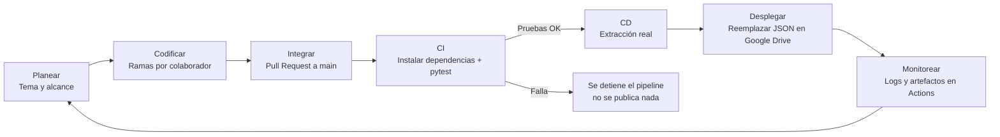
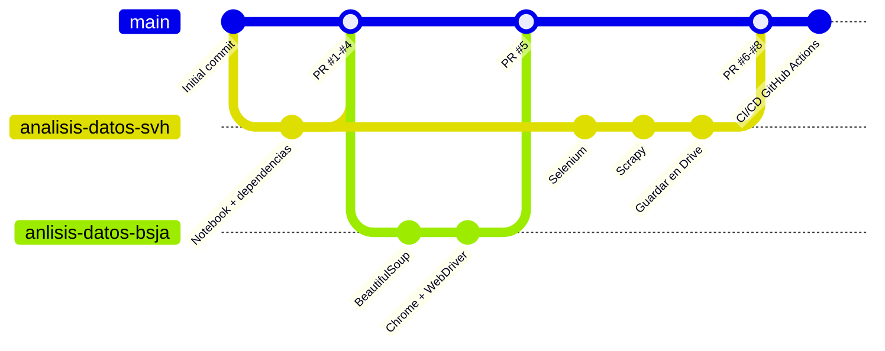
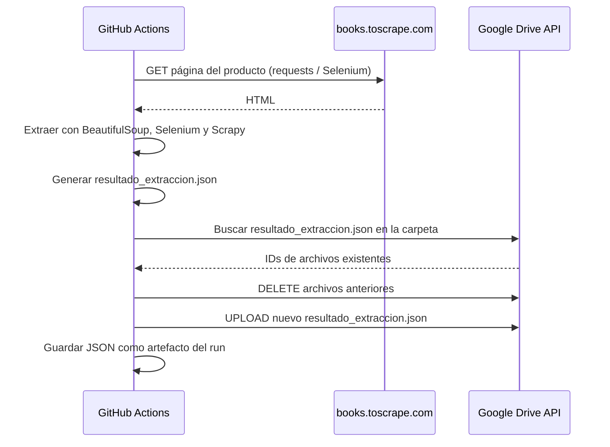

# p-analisis_datos-g10
Repositorio Remoto colaborativo para Evidencia de aprendizaje 2 . Optimizando la productividad en el mundo del software

## Estructura

| Ruta | Descripción |
|------|-------------|
| `p-analisis_datos-g10.ipynb` | Notebook original (Google Colab) |
| `src/extraccion.py` | Extracción con BeautifulSoup, Selenium y Scrapy |
| `src/drive.py` | Borra `resultado_extraccion.json` en Google Drive y sube el nuevo |
| `src/main.py` | Punto de entrada (`python -m src.main [--drive]`) |
| `tests/` | Pruebas automatizadas (pytest, sin conexión a internet) |
| `.github/workflows/ci-cd.yml` | Pipeline CI/CD de GitHub Actions |
| `scripts/obtener_token_drive.py` | Script único para obtener el token de Google Drive |

## Ejecución local

```bash
pip install -r requirements-dev.txt
pytest                      # pruebas
python -m src.main          # genera resultado_extraccion.json (requiere Google Chrome)
```

## CI/CD con GitHub Actions

- **CI (`pruebas`)**: se ejecuta en cada push y pull request a `main`.
- **CD (`extraccion-y-despliegue`)**: si las pruebas pasan (en push a `main` o ejecución manual), extrae los datos,
  **elimina** `resultado_extraccion.json` de la carpeta de Drive y **sube uno nuevo**. El JSON también queda como artefacto del run.
- Ejecución manual: pestaña **Actions → CI/CD - Extraccion de datos → Run workflow**.

### Configuración de Google Drive (una sola vez)

1. En [Google Cloud Console](https://console.cloud.google.com/) crea un proyecto y habilita **Google Drive API**.
2. **Google Auth Platform → Público (pantalla de consentimiento)**: tipo *Externo*, agrega tu correo como usuario de prueba y luego
   pulsa **Publicar app** (en modo *Prueba* el token caduca a los 7 días).
3. **Clientes → Crear cliente → App de escritorio**. Descarga el JSON y guárdalo como `scripts/client_secret.json` (está en `.gitignore`).
4. En tu equipo:
   ```bash
   pip install google-auth-oauthlib
   python scripts/obtener_token_drive.py
   ```
   Inicia sesión con la cuenta dueña del Drive; el script imprime `GDRIVE_CLIENT_ID`, `GDRIVE_CLIENT_SECRET` y `GDRIVE_REFRESH_TOKEN`.
5. Abre la carpeta `MyDrive/p-analisis_datos-g10` en Drive; el ID es la última parte de la URL
   (`https://drive.google.com/drive/folders/1jCOvwHmQdIbrbsYr1WNNl2mjjXn7hlBi`).
6. En GitHub: **Settings → Environments → New environment** llamado `test`, y agrega ahí los secrets
   `GDRIVE_CLIENT_ID`, `GDRIVE_CLIENT_SECRET`, `GDRIVE_REFRESH_TOKEN` y `GDRIVE_FOLDER_ID`.

---

## Flujo de trabajo DevOps implementado

El proyecto aplica el ciclo DevOps (**Planear → Codificar → Construir → Probar → Liberar/Desplegar → Operar → Monitorear**)
a un caso de **monitorización competitiva de precios y disponibilidad** en comercio electrónico. El objetivo es que la
captura de precio y stock se haga de forma **repetible, verificada y automatizada**, sin depender de ejecutar a mano un notebook.



### 1. Planear

- **Problema:** en mercados digitales los precios y el inventario cambian constantemente. Capturarlos de forma
  confiable permite analizar la estrategia de los competidores y alimentar modelos de *Dynamic Pricing*.
- **Alcance:** extraer título, precio, disponibilidad y UPC de un producto de `books.toscrape.com` con tres técnicas
  (BeautifulSoup, Selenium y Scrapy) y publicar un resultado unificado en `resultado_extraccion.json`.

### 2. Codificar y control de versiones (Git + GitHub)

Se usa una estrategia de **feature branches**: cada colaborador trabaja en su propia rama y nada llega a `main` sin un Pull Request.

| Rama | Responsable | Aporte principal |
|------|-------------|------------------|
| `analisis-datos-svh` | Santiago Valencia H | Entorno Colab, Selenium, Scrapy, persistencia en Drive |
| `anlisis-datos-bsja` | Santiago Jaramillo | Extracción estática con BeautifulSoup, instalación de Chrome/WebDriver |
| `analisis-datos-jmho` | Colaborador jmho | Rama de trabajo habilitada |
| `main` | Rama de integración | Solo recibe cambios vía Pull Request |



**Buenas prácticas aplicadas:**
- Commits pequeños con mensajes descriptivos (una técnica o funcionalidad por commit).
- Pull Requests como punto de revisión e integración, lo que deja trazabilidad de quién aportó qué y cuándo.
- `.gitignore` evita versionar credenciales (`client_secret*.json`, `token*.json`), cachés y el JSON generado.

### 3. Construir (Build)

El notebook de Colab no se puede ejecutar en un servidor de integración (usa `drive.mount` y comandos `!apt-get`).
Por eso la lógica se **refactorizó en módulos Python reutilizables y testeables**:

| Módulo | Responsabilidad |
|--------|-----------------|
| `src/extraccion.py` | Descargar el HTML y extraer los datos con BeautifulSoup, Selenium y Scrapy; unificar y guardar el JSON |
| `src/drive.py` | Conectarse a la API de Google Drive, eliminar versiones anteriores del archivo y subir la nueva |
| `src/main.py` | Orquestar el proceso completo (`python -m src.main --drive`) |

Las dependencias se declaran en `requirements.txt` (ejecución) y `requirements-dev.txt` (incluye `pytest`), lo que
hace el entorno **reproducible** en cualquier máquina o runner.

### 4. Probar (Integración Continua – CI)

El job **`CI - Pruebas automatizadas`** se ejecuta en cada `push` y en cada `pull_request` hacia `main`:

1. `actions/checkout` descarga el código.
2. `actions/setup-python` instala Python 3.12 con caché de `pip`.
3. Instala `requirements-dev.txt`.
4. Ejecuta `pytest -v`.

Las pruebas **no dependen de internet ni de credenciales**. Usan una copia del HTML (`tests/fixtures/libro.html`) y *mocks* de la API de Drive:

| Prueba | Qué valida |
|--------|------------|
| `test_extraer_con_bs4` | Título, precio y disponibilidad extraídos con BeautifulSoup |
| `test_extraer_con_scrapy` | Título, precio y UPC extraídos con Scrapy |
| `test_construir_resultado_y_guardar_json` | Estructura del JSON unificado y escritura en disco |
| `test_descargar_html_decodifica_utf8` | Que el símbolo `£` no se corrompa (error real detectado y corregido) |
| `test_ejecutar_sin_drive` | El flujo completo de `main` sin publicar en Drive |
| `test_reemplazar_borra_anteriores_y_sube_nuevo` | Que se eliminen los JSON previos antes de subir el nuevo |
| `test_reemplazar_sin_archivo_previo_solo_sube` | Que funcione aunque la carpeta esté vacía |

Si alguna prueba falla, **el pipeline se detiene** y no se publica información posiblemente corrupta.

### 5. Liberar y desplegar (Despliegue Continuo – CD)

El job **`CD - Extraer y publicar en Google Drive`** depende de que el CI termine bien (`needs: pruebas`) y solo se ejecuta en
`push` a `main` o de forma manual (`workflow_dispatch`). **Nunca se ejecuta en Pull Requests**, así el código no revisado no puede desplegar.



- Selenium usa el Google Chrome preinstalado en `ubuntu-latest` en modo *headless*.
- El JSON se publica en Google Drive y además queda como **artefacto descargable** en cada ejecución.
- `concurrency` evita que dos ejecuciones simultáneas modifiquen el archivo de Drive al mismo tiempo.

### 6. Operar

| Disparador | Qué ejecuta |
|------------|-------------|
| `push` a `main` | CI + CD (extracción y publicación) |
| `pull_request` a `main` | Solo CI (pruebas) |
| Manual: **Actions → CI/CD - Extraccion de datos → Run workflow** | CI + CD bajo demanda |
| `schedule` (opcional, comentado en el workflow) | CI + CD periódico, por ejemplo diario, para construir series de tiempo de precios |

### 7. Monitorear

- La pestaña **Actions** registra cada ejecución con su estado (✅/❌), duración y logs por paso.
- Los logs muestran los datos extraídos por cada técnica y los IDs del archivo eliminado y del nuevo en Drive.
- GitHub notifica por correo cuando un workflow falla. Por ejemplo, si el sitio cambia su HTML y las pruebas o la extracción dejan de funcionar.

### Seguridad y gestión de secretos

- Las credenciales de Google (OAuth 2.0) **nunca se versionan**. Se guardan como *secrets* cifrados en el entorno `test` de GitHub:
  `GDRIVE_CLIENT_ID`, `GDRIVE_CLIENT_SECRET`, `GDRIVE_REFRESH_TOKEN` y `GDRIVE_FOLDER_ID`.
- El workflow tiene `permissions: contents: read` (privilegio mínimo).
- El *refresh token* se genera una sola vez en local con `scripts/obtener_token_drive.py`.

### Resultado de la primera ejecución automatizada

| Etapa | Estado | Duración aprox. |
|-------|--------|-----------------|
| CI - Pruebas automatizadas (7 pruebas) | ✅ Éxito | 23 s |
| CD - Extracción (BeautifulSoup, Selenium, Scrapy) y publicación en Drive | ✅ Éxito | 35 s |
| **Total del pipeline** | ✅ | **~60 s** |

Las tres técnicas obtuvieron los mismos datos: *A Light in the Attic*, **£51.77**, *In stock (22 available)*, UPC `a897fe39b1053632`.
El archivo anterior se eliminó de Drive y se publicó la versión nueva.
